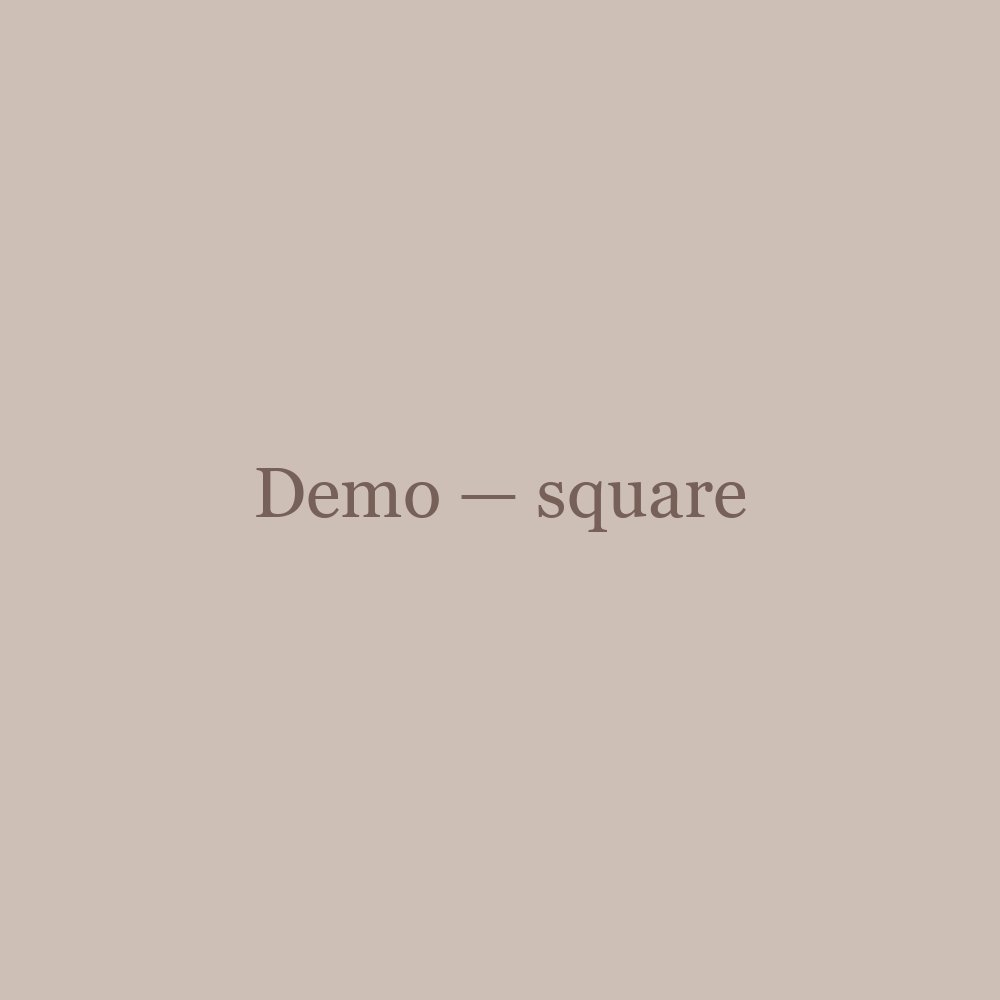
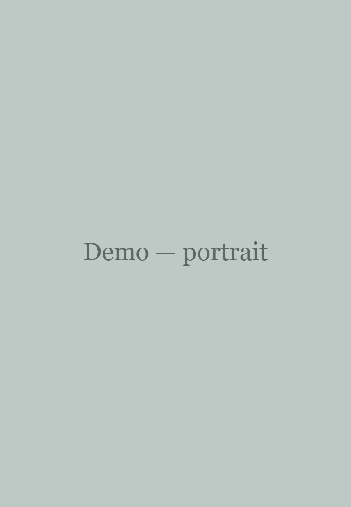

**This is a demonstration post.** It exists only so you can see how the article page handles different kinds of formatting. It is marked as a draft, so it never appears on the live site. Delete this file, along with the other `demo-` files in `src/content/posts/` and `src/content/images/`, whenever you like.

This first paragraph is ordinary body text. It is long enough to wrap across several lines, so you can judge the line length, the line height and the spacing between paragraphs. A comfortable measure for reading is roughly sixty to seventy-five characters per line.

Here is a second paragraph with a [link to somewhere](https://example.com), some *italic text*, some **bold text**, and a bit of `inline code`. Quotation marks and dashes are converted automatically: "like this" -- and 'like this'.

## A second-level heading

Use `##` headings to divide a longer piece into sections. Most posts won't need any headings at all.

### A third-level heading

Use these sparingly, for subsections.

#### A fourth-level heading

These are rendered in italics and are rarely needed.

## Lists

An unordered list:

- The first item
- A second item, which is a little longer so that it wraps onto a second line on narrower screens
- A third item
  - A nested item

An ordered list:

1. First
2. Second
3. Third

## Quotations

> This is a blockquote. Use it for quoting someone else's words. It can run across several lines and contain *emphasis* or [links](https://example.com).
>
> A blockquote can have more than one paragraph.

## Images

An image inside the article. The italic line directly underneath becomes the caption:


*This is a caption. Write it on the line directly below the image, in italics.*

Images without a caption are fine too:



## Code

A block of code:

```js
function greet(name) {
  return `Hello, ${name}.`;
}

console.log(greet('reader'));
```

## A table

| Column | Another column |
| ------ | -------------- |
| One    | Two            |
| Three  | Four           |

## A section break

A horizontal rule appears as a small row of asterisks:

---

## Footnotes

Footnotes are supported.[^1]

[^1]: This is a footnote. It appears at the bottom of the article.
